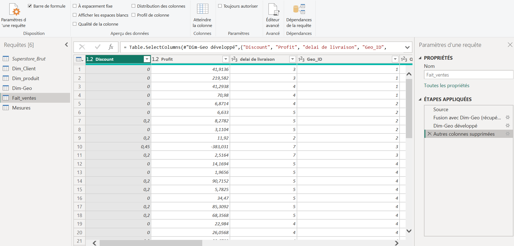
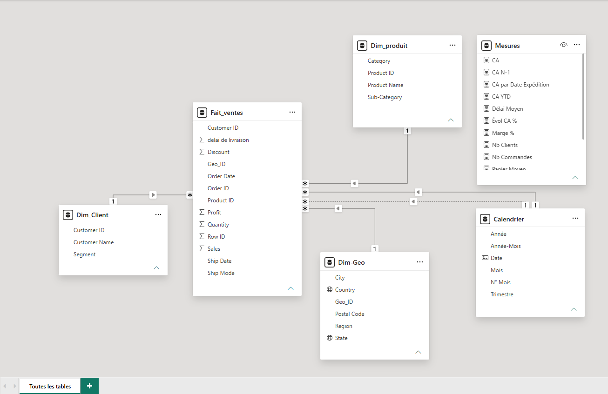
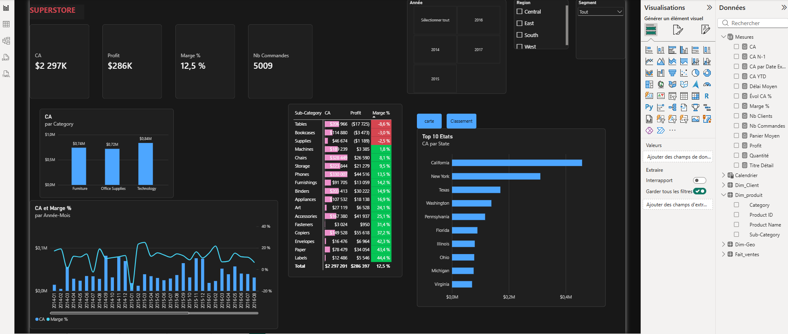
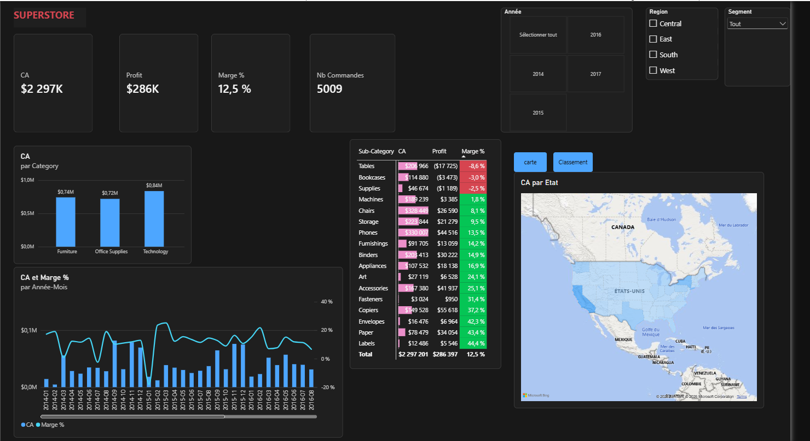
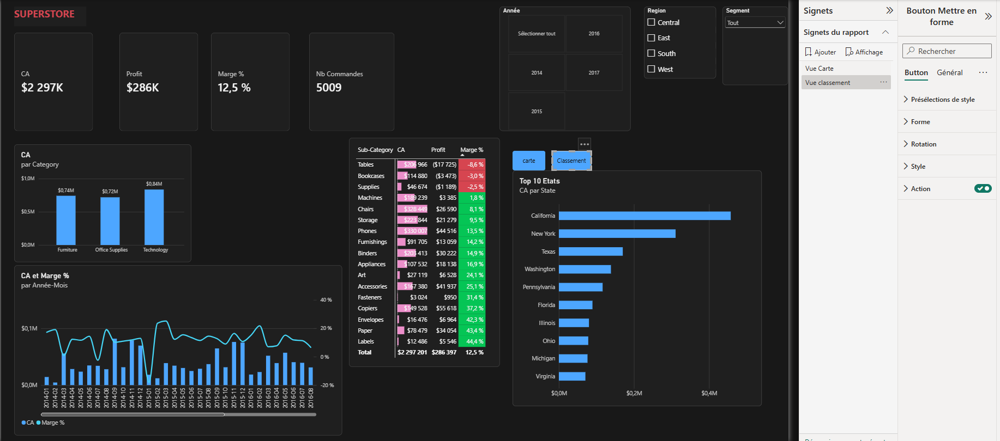
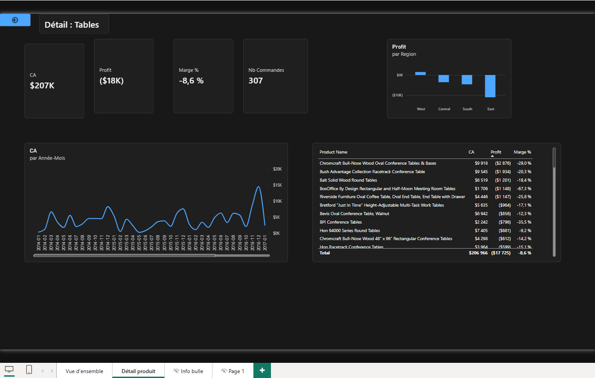
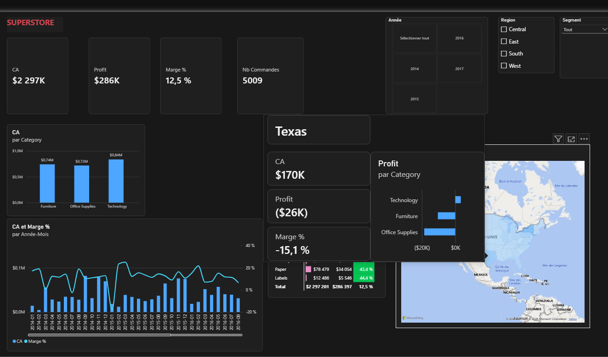
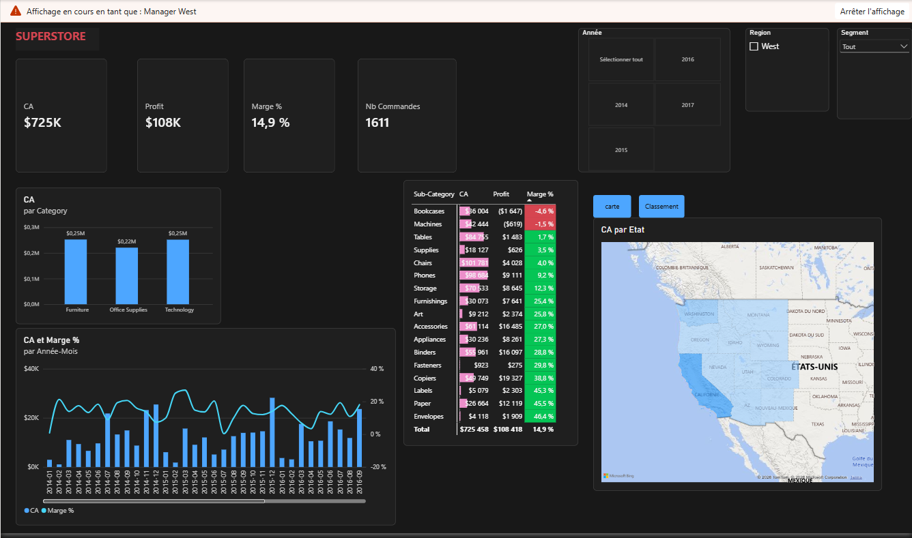

# 📊 Superstore – Analyse de la performance commerciale (Power BI)

Projet personnel réalisé sur **Power BI Desktop** par **Hélène Kone**, ingénieure spécialisée en data, gestion de projet et transformation digitale.

L'objectif : construire de bout en bout un rapport décisionnel à partir de données brutes de ventes (magasin « Superstore », 2014-2017, ~10 000 lignes), en mobilisant les principales fonctionnalités de Power BI : préparation des données, modélisation, DAX, visualisation, navigation et sécurité.

---

## 🎯 Problématique métier

> Quels produits, régions et périodes portent la croissance du chiffre d'affaires, et où l'entreprise perd-elle de l'argent ?

---

## 🗂️ Contenu du dépôt

| Fichier | Description |
|---|---|
| `Superstore-Analyse-Ventes.pbix` | Le rapport Power BI complet |
| `Superstore-Analyse-Ventes.pdf` | Export PDF du rapport |
| `captures/` | Captures d'écran des étapes clés |

**Source des données :** [Superstore Dataset – Kaggle](https://www.kaggle.com/datasets/vivek468/superstore-dataset-final)

---

## 🔧 1. Préparation des données (Power Query)

- Import du fichier CSV et gestion de l'encodage
- **Typage avec paramètres régionaux** (Anglais – États-Unis) pour les dates au format américain et les nombres à point décimal
- Contrôle qualité avec les outils de profilage (qualité, distribution et profil de colonne) : 0 % d'erreurs, 0 % de valeurs vides
- **Colonnes personnalisées en langage M** (délai de livraison en jours)
- Découpage de la table brute en tables de dimensions via des **références de requêtes**
- **Dédoublonnage** et traitement d'un problème de qualité : certains identifiants produits avaient plusieurs libellés, une règle de dédoublonnage sur l'identifiant a été appliquée
- Création d'une **clé de substitution** (colonne d'index) pour la géographie, puis **fusion de requêtes** pour la rattacher à la table de faits
- Désactivation du chargement de la table source pour alléger le modèle



---

## 🧩 2. Modélisation : schéma en étoile

- 1 table de faits : `Fait_ventes`
- 4 dimensions : `Dim_Client`, `Dim_produit`, `Dim-Geo`, `Calendrier`
- Table **Calendrier** créée en DAX et marquée comme table de dates (date/heure automatique désactivée)
- Relations **1 → plusieurs** à filtrage unidirectionnel
- **Relation inactive** entre le calendrier et la date d'expédition, activée à la demande en DAX
- Table dédiée aux mesures



---

## 🧮 3. Mesures DAX

| Mesure | Fonctions utilisées |
|---|---|
| CA, Profit, Quantité | `SUM` |
| Marge %, Panier moyen | `DIVIDE` (gestion de la division par zéro) |
| Nb commandes, Nb clients | `DISTINCTCOUNT` |
| CA N-1, Évolution CA % | `CALCULATE`, `SAMEPERIODLASTYEAR`, `HASONEVALUE` (contrôle des totaux) |
| CA cumulé annuel | `TOTALYTD` |
| CA par date d'expédition | `USERELATIONSHIP` (activation de la relation inactive) |
| Titres dynamiques | `SELECTEDVALUE` |

Exemple :

```DAX
CA N-1 =
IF (
    HASONEVALUE ( Calendrier[Année] ),
    CALCULATE ( [CA], SAMEPERIODLASTYEAR ( Calendrier[Date] ) )
)
```

> Choix de conception : les ratios (marge %) sont calculés en **mesures** et non stockés ligne par ligne, car un pourcentage ne s'additionne pas.



---

## 📈 4. Rapport et fonctionnalités de visualisation

**Page « Vue d'ensemble »**
- Bandeau de KPI (CA, Profit, Marge %, Nb commandes)
- Graphique combiné CA / Marge % par mois
- CA par catégorie avec **exploration hiérarchique** (catégorie → sous-catégorie)
- **Carte remplie** par État avec dégradé de couleurs
- Matrice avec **mise en forme conditionnelle** (règles rouge/vert sur la marge, barres de données sur le CA)
- **Segments** : année, région, segment client



**Signets et boutons** : bascule entre la carte et un **Top 10 des États** (filtre Top N) au même emplacement.



**Page « Détail Produit »** : navigation par **extraction (drill-through)** depuis n'importe quelle sous-catégorie, avec titre dynamique et bouton retour.



**Info-bulle personnalisée** : au survol d'un État, une mini-page affiche son nom, ses KPI et son profit par catégorie.



---

## 🔐 5. Sécurité et performance

- **Sécurité au niveau des lignes (RLS)** : un rôle par responsable régional (West, East, Central, South) et un rôle Direction sans restriction, testés avec la fonction « Afficher en tant que »
- **Analyseur de performances** : tous les visuels se chargent en moins de 500 ms. Pour le visuel le plus lourd (la matrice), le calcul DAX ne prend que quelques millisecondes ; l'essentiel du temps est consacré au rendu de la mise en forme conditionnelle.




---

## 💡 Principaux enseignements

- **CA total de 2,30 M$** pour **286 K$ de profit** (marge de **12,5 %**), sur 5 009 commandes.
- **Forte croissance** après un léger recul en 2015 (-2,8 %) : **+29,5 % en 2016** et **+20,4 % en 2017**.
- **Trois sous-catégories sont déficitaires** : Tables (-8,6 %), Bookcases (-3,0 %) et Supplies (-2,5 %). Machines génère un CA important pour une marge très faible (1,8 %).
- **Le Texas**, 3ᵉ marché en CA (170 K$), est **déficitaire** (-26 K$, marge de -15,1 %), principalement à cause du mobilier et des fournitures de bureau.
- **La région West** est la plus rentable (marge de 14,9 %). Les Tables y sont rentables, alors qu'elles perdent de l'argent au niveau national : leurs pertes sont concentrées à l'**Est**.

**Piste d'approfondissement :** analyser le lien entre le niveau de remise et la marge, afin de vérifier si des remises trop élevées expliquent les pertes par région et par produit.

---

## 🛠️ Compétences mobilisées

`Power BI Desktop` · `Power Query (M)` · `Modélisation en étoile` · `DAX` · `Intelligence temporelle` · `Data visualisation` · `Drill-through` · `Signets` · `RLS` · `Analyse de performance` · `Qualité des données`

---

👤 **Hélène Kone** – Ingénieure ICAM, spécialisée en data, gestion de projet et transformation digitale
